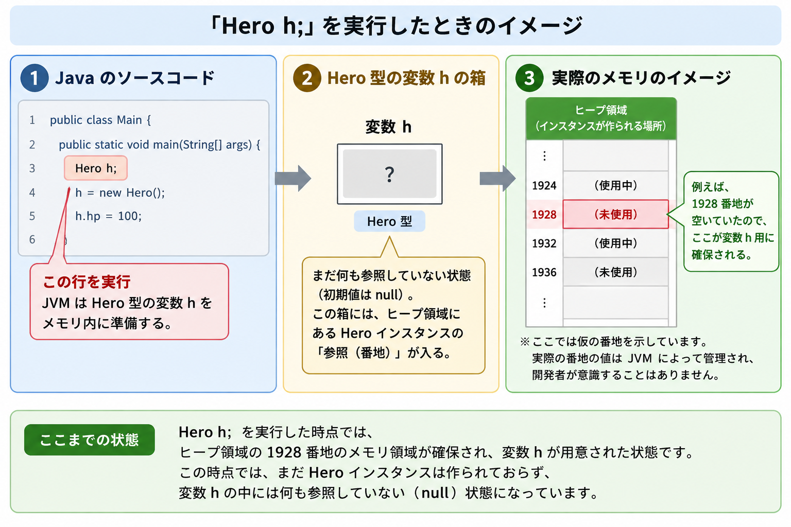
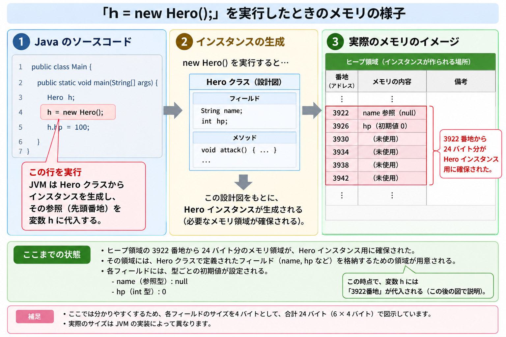
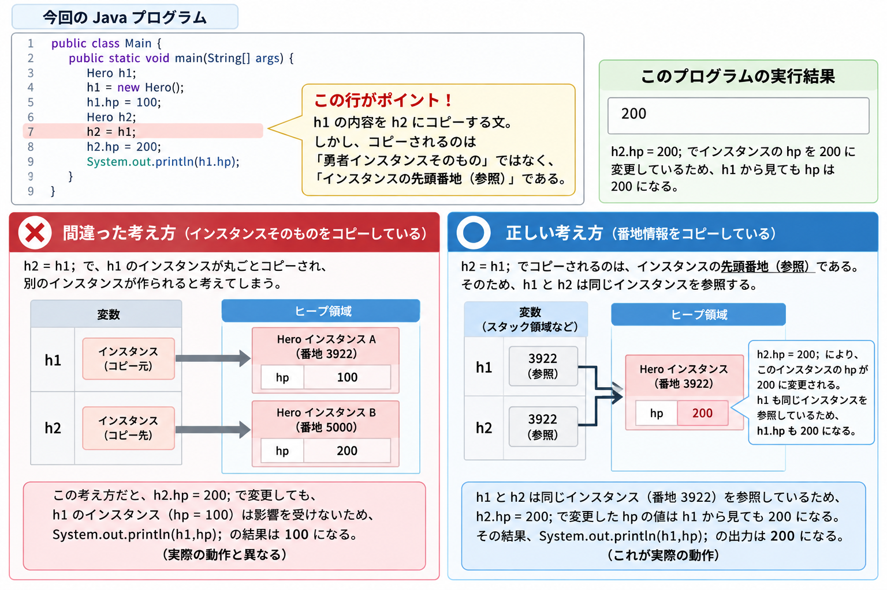
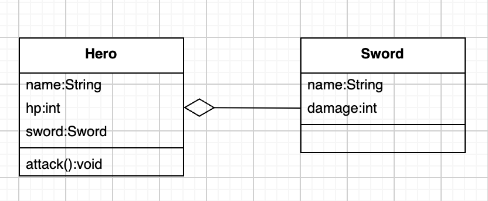
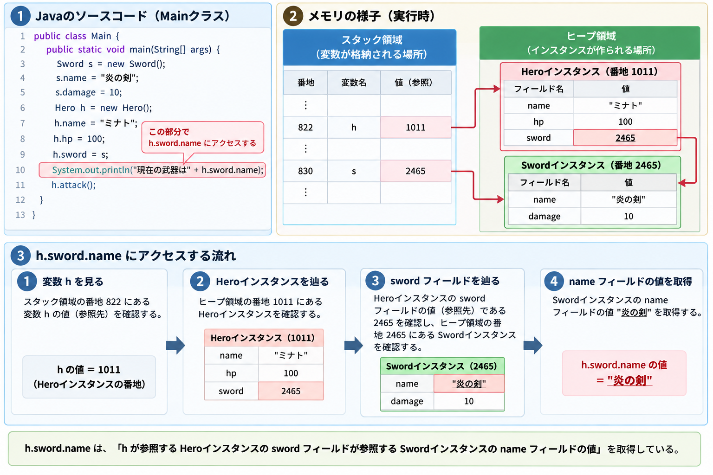
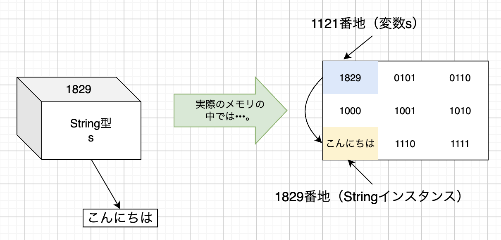
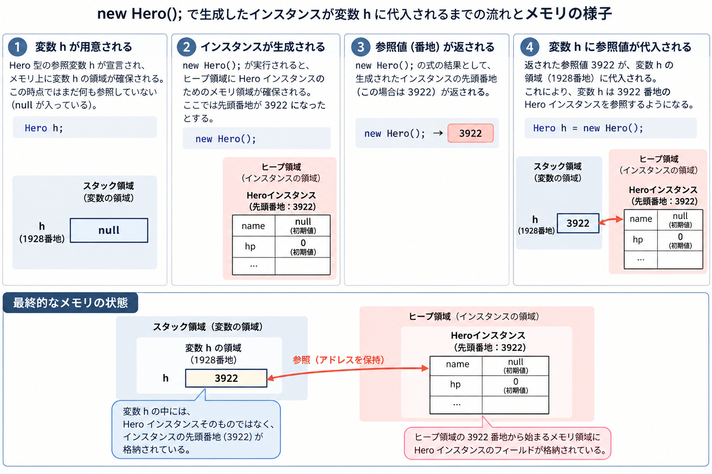
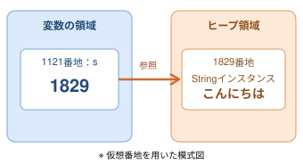
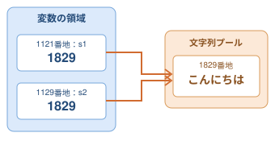

# 第9章

学習日:  
1周目：2026-09-04 〜 2026-09-27  
2周目：2026/10/23 〜 

## 学んだこと
- クラス型と参照
  - 仮想世界の真の姿
  - クラス型変数とその内容
  - STEP1:Hero型変数とその確保
  - STEP2:Heroインスタンスの生成
  - STEP3:参照の代入
  - STEP4:フィールド値への代入
  - 同一インスタンスを指す変数
  - クラス型をフィールドに用いる
  - クラス型をメソッド引数や戻り値に用いる
  - String型の真実
- コンストラクタ
  - 生まれたてのインスタンスの状態
  - フィールド初期値を自動設定する
  - コンストラクタの定義方法
  - コンストラクタに情報を渡す
  - 2つ以上の同名のコンストラクタを定義する
  - 暗黙のコンストラクタ
  - 他のコンストラクタを呼び出す

## 詰まったこと

練習9-2のプログラムの説明
（1周目の段階では理解できておらず）

## 用語集
- ヒープ：Javaプログラムの実行時に、生成されたオブジェクトや配列の実体を格納するメモリ領域のこと。
- 参照型：配列型(int[]型やString[]型など)とクラス型(Hero型など)の総称。
- 参照の解決：変数から番地情報を取り出し、その番地にアクセスするというJVMの動作のこと。アドレス解決ともいう。
- インスタンスの独立性：同じクラスから生まれた異なるインスタンスは互いに影響を受けない性質。
- has-a関係：あるクラスが別のクラスをフィールドとして利用している関係のこと。
- コンストラクタ：newした直後に自動的に実行される特別な性質を持ったメソッドのこと。
- デフォルトコンストラクタ：引数なし、処理内容なしのコンストラクタ。コンパイル時に自動追加される。

## 1. クラス型と参照

### 1-1. 仮想世界の真の姿

chapter07およびchapter08では、インスタンスのことを  
「操作と属性を持ち、コンピュータ内の仮想世界に生み出される登場人物」という概念的な表現で紹介してきた。  
しかし、本当に「勇者」や「お化けキノコ」のような存在がコンピュータ内に生まれ、あれこれと活躍するわけではない。

これまで「Javaの仮想世界」と表現してきたものは、  
実際にはコンピュータのメモリ領域である。  
この領域は、Javaプログラム実行時に、  
JVMがメモリ領域を大量に（通常は数百MB〜数GB）を使って準備するもので、  
これをヒープと言う。

自分たちがnewを用いてインスタンスを生み出すたびに、  
ヒープの一部の領域（通常は数十〜数百バイト）が確保され、  
インスタンスの情報を格納するために利用される。  
そのため、多くの属性を持った大きなクラスをインスタンス化すると、  
消費されるヒープ領域は必要とする容量に従って大きくなる。

つまり、インスタンスとは**ヒープの中に確保されたメモリ領域**にすぎない。

### 1-2. クラス型変数とその内容

インスタンスの正体は「ヒープの一部に確保された単なるメモリ領域」だが、  
そのインスタンスが生まれる際にコンピュータの中で何が起こっているのかを探ってみる。

chapter08/src/Main.javaの一部を抜粋し改変
```
public class Main {
    public static void main(String[] args) {
        Hero h;
        h = new Hero();
        h.hp = 100;
    }
}
```

### 1-3. STEP1:Hero型変数とその確保

上記で最初に動くのは、`Hero h;`である。  
この行を実行すると、JVMは「Hero型の変数h」をメモリ内に準備する。  
JVMはヒープ領域の中から現在利用していないメモリ領域を探し出して確保してくれる。  
仮に1928番地が空いていたとして、ここが変数h用に確保されたとする。  
以下はそのイメージである。



まだこの段階では勇者自体は生まれてはいない。  
「Hero型のインスタンスだけを中に入れることができる」Hero型の箱が準備されるだけである。  
この箱には数値や文字列を入れることはできない。  
また、Hero型ではない「お化けキノコ」インスタンスを入れることもできない。

### 1-4. STEP2:Heroインスタンスの生成

`h = new Hero();`は代入文である。  
代入は左辺より右辺の方が先に評価されるので、  
まず`new Hero()`の部分だけを考える。  
`new Hero()`が実行されると、JVMはヒープ領域から必要な量のメモリを確保する。
以下の図は、3922番地から24バイト分が確保できたときのイメージ図である。



### 1-5. STEP3:参照の代入

STEP2では、`h = new Hero();`の右辺について考えた。  
newによって生み出された勇者インスタンスは、  
変数hに代入される。  

これまで変数hに入るのは「勇者インスタンス」だと紹介してきたが、  
より厳密には勇者インスタンスの情報が書き込まれた「メモリの先頭番地」が入る。  

今回の場合、`new Hero()`により、勇者インスタンスが3922番地〜3945番地に生成されているので、  
変数hには3922という数値が代入される。

変数hに入っている3922は、ただの数値にすぎない。  
Heroインスタンスに関する名前やHPなどの様々な情報は変数hの中ではなく、  
別のところに入っている。

再度おさらいすると、  
変数hそのものは1928番地に存在しており、  
その変数hの中身は参照先の先頭番地に当たる3922が入っている。  
3922番地より24バイトを使用して、Heroインスタンスに関する名前やHPのフィールドが入る。

見方を変えれば、「この変数hにはHeroインスタンスの情報は全部入り切らないから、  
詳しくは3922番地を参照してください」と解釈できる。  
このことから、変数hに入っているアドレス情報を参照という。  

「あれ...どっかで聞き覚えのあるような...。」

実はchapter04の配列型と同じ仕組みである。

int[]型もString[]型といった「配列型」も、  
変数が入っているのは配列内の各データが保存されているメモリ領域の先頭番地である。  
Hero型のような「クラス型」も同様である。  
このことから、クラス型と配列型を総称して参照型と呼ばれる。

### 1-6. STEP4:フィールド値への代入

最後の`h.hp = 100;`では、変数hに格納されている勇者のHPを100に設定する。  
JVMは以下のように解釈して実行する。

1. 変数hの内容を調べると、「3922番地を参照せよ」と書かれている。
2. メモリ内の3922番地にあるインスタンスのメモリ領域にアクセスし、その中のhpフィールド部分を100に書き換える。

このように、まず変数から番地情報を取り出し、  
次にその番地にアクセスするというJVMの動作を  
参照の解決またはアドレスの解決という。

### 1-7. 同一インスタンスを指す変数

仮想世界に勇者が2人生成され、  
それぞれh1、h2という変数に格納されていたとする。  
勇者h1のhpフィールドを10減らしても、  
勇者h2のhpフィールドは減らない。  

同じクラスから生まれても、  
異なるインスタンスであれば互いに影響を受けないことをインスタンスの独立性という。

以下のコードの場合について考える。

```
public class Main {
    public static void main(String[] args) {
        Hero h1;
        h1 = new Hero();
        h1.hp = 100;
        Hero h2;
        h2 = h1;
        h2.hp = 200;
        System.out.println(h1.hp);
    }
}
```

このプログラムを正しく理解するためのポイントは、  
7行目の`h2 = h1;`である。  
これはh1の内容をh2にコピーする文であるが、  
勇者インスタンスhのために確保してあるメモリの先頭番地を思い出してみよう。  
ここでコピーされているのは「勇者インスタンス」ではなく、  
**3922などの番地情報**である。



代入の結果、h1とh2に同じ3922番地が入ることになる。  
したがって、h1とh2はどちらも「まったく同じ1人の勇者インスタンス」を指していることになる。  
そのため、h1のhpフィールドへ代入しても、  
h2のhpフィールドに代入しても、  
結局は同じ勇者インスタンスのHPに代入することになる。

上記のコードのプログラムの場合、  
勇者インスタンスのhpフィールドにはh1で100が代入されるが(`h1.hp = 100;`)、  
その後に同じhpフィールドにh2経由で200が上書きされる(`h2.hp = 200;`)。  
よって、最後に表示される`System.out.println(h1.hp);`は200である。

### 1-8. クラス型をフィールドに用いる

chapter09/code09-01/src/Sword.java
```
public class Sword {
    String name;
    int damage;
}
```

chapter09/code09-01/src/Hero.java
```
public class Hero {
    String name;
    int hp;
    Sword sword;

    public void attack(){
        System.out.println(this.name + "は攻撃した！");
        System.out.println("敵に5ポイントのダメージをあたえた！");
    }
}
```

Heroクラスに新しく追加されたフィールド「sword」は、  
int型やString型ではなく、Sword型である。  
このようにフィールドにクラス型を変数を宣言することも可能。  
今回の例のように、「あるクラスが別のクラスをフィールドとして利用している関係」をhas-a関係という。
図にすると以下のようになる。



「has-a」と呼ぶ理由は、以下のような英文が自然と成立するため。

**Hero has-a Sword(勇者は剣を持っている)**

この2つのクラスを利用するMainクラスは以下のようになる。

```
public class Main {
    public static void main(String[] args) {
        Sword s = new Sword();
        s.name = "炎の剣";
        s.damage = 10;
        Hero h = new Hero();
        h.name = "ミナト";
        h.hp = 100;
        h.sword = s;
        System.out.println("現在の武器は" + h.sword.name);
        h.attack();
    }
}
```

このときのメモリの様子は以下のようになる。



822番地にある変数hには、勇者インスタンスのアドレス値(1011番地)が入っている。  
そして勇者インスタンスに含まれるsword領域には、剣インスタンスのアドレス値(2465番地)が格納されている。  
すなわち、先ほどの「Hero has-a Sword」関係が成立しており、  
HeroクラスがSwordクラスをフィールドとして利用しているのがわかる。

### 1-9. クラス型をメソッド引数や戻り値に用いる

クラス型はフィールドの型に用いるだけでなく、  
メソッドの引数や戻り値の型としても利用できる。  
ここで、既にある勇者(Hero)クラスに加え、魔法使い(Wizard)クラスを作成してみる。  
魔法使いは、勇者のHPを回復する魔法(heal)をつかうことができる。

chapter09/code09-02/src/Wizard.java
```
public class Wizard {
    String name;
    int hp;

    public void heal(Hero h){
        h.hp += 10;
        System.out.println(h.name + "のHPを10回復した！");
    }
}
```
healメソッドが呼び出されると、  
魔法使いインスタンスは勇者のHPを10回復させる。  
ただし、仮想世界には勇者が2人以上生み出されている(2回以上newされている)可能性もあるため、  
呼び出されるときに「どの勇者を回復するのか」を引数hとして受け取る必要がある。  
(上記の`public void heal(Hero h)`の部分)

実際にこの魔法使いクラスを利用してみる。

chapter09/code09-02/src/Main.java
```
public class Main{
    public static void main(String[] args) {
        Hero h1 = new Hero();
        h1.name = "ミナト";
        h1.hp = 100;
        Hero h2 = new Hero();
        h2.name = "アサカ";
        h2.hp = 100;
        Wizard w = new Wizard();
        w.name = "スガワラ";
        w.hp = 50;
        w.heal(h1); // ミナトを回復させる(HP100→110)
        w.heal(h2); // アサカを回復させる(HP100→110)
        w.heal(h2); // アサカを回復させる(HP110→120)
    }
}
```
これに伴い、Heroクラスも以下に変更している。

chapter09/code09-02/src/Hero.java
```
public class Hero {
    String name;
    int hp;
}
```

### 1-10. String型の真実

chapter01から当たり前のように登場していたString型であるが、  
実はint型やdouble型の仲間ではなく**Hero型の仲間**である。  
これまで「String型変数の中には文字列がそのまま入っている」と解釈していたかもしれないが、  
本当の姿は以下のようになっている。



ここで疑問が残る。  
Hero型はSword型は自分自身でHeroクラスとSwordクラスを定義したことで使用可能になった。  
しかしStringクラスを定義していないにも関わらず、自分たちがString型を使用できるのはなぜか？  
この答えは、APIリファレンスが明らかにしてくれる。  
MathクラスやSystemクラスのようにAPIとして標準添付されている膨大な数のクラスの中に、  
Stringクラスが含まれているからである。  
(Stringクラスは正式にはjava.lang.Stringクラスである。)

詳しくは下記参照  
https://docs.oracle.com/javase/jp/8/docs/api/java/lang/String.html

これまでString型を「int型と似たようなもの」として扱い続け、  
このchapterに至るまで「実はJavaが準備してくれていたクラスを使い続けていた」と気づかなかった理由は、  
Javaというプログラミング言語が作られるときに、次のような特別の配慮をされたためである。

**①java.langパッケージに宣言されている**

chapter06で紹介した通り、java.langパッケージに所属するクラスを利用する場合、  
特例としてimport文を記述する必要がない。  
(chapter06のAPIで提供されるパッケージの項目を参照)  

本来は`java.lang.String s;`と宣言する必要があるのだが、  
単に`String s;`と書けば利用できるようになっている。

**②二重引用筆文字を囲めばインスタンスを生成して利用できる**

通常、インスタンスを生成するにはnew演算子を利用する必要がある。  
しかし文字列はプログラムの中で多用されるため、  
その都度newを書いていたらソースコードがnewだらけになってしまう。  

そこで、「二重引用符で文字列を囲めば、その文字列情報をを持ったStringインスタンスを利用できる」という特例を設けられた。  
new演算子を使うことなく`String s = "こんにちは";`というシンプルな記述が可能になっている。

実はStringもクラスには違いないので、  
HeroやSwordと同じようにnewでインスタンスを生成することもできる。  
ただし、この方法は効率が悪いので非推奨となっている。

```
public class Main{
  public static void main(String[] args){
    String s = new String("こんにちは");
    System.out.println(s);  // 画面に「こんにちは」と表示される。 
  }
}
```
3行目に`String s = new String("こんにちは");`と記述している。  
今までは`String s = new String();`と書くのが普通であるが、  
Stringクラスはnewするとき、ついでに追加情報を指定できる特別なしくみに対応している。  
このしくみについてはHeroクラスやSwordクラスにも使える。  
その特別なしくみについては後述する。

## 2. コンストラクタ

### 2-1. 生まれたてのインスタンスの状態

前節でJavaの仮想世界で起きている真実を学んだ。  
これにより、オブジェクト指向の考え方に沿って、  
インスタンスを自由に生み出して利用することができるようになった。  
しかし、実際にクラスを用いたプログラムを書き始めると、  
ある「煩わしさ」を感じるようになる。  
その例として、魔法使いクラスを利用するプログラムの一部を抜粋して下記に示す。

chapter09/code09-02/src/Main.javaの一部を抜粋
```
Hero h1 = new Hero();     //  インスタンスの生成
h1.name = "ミナト";        //  初期値セット      
h1.hp = 100;              //  初期値セット
Hero h2 = new Hero();     //  インスタンスを生成
h2.name = "アサカ";        //  初期値セット
h2.hp = 100;              //  初期値セット
Wizard w = new Wizard();  //  インスタンスを生成
w.name = "スガワラ";       //  初期値セット
w.hp = 50;                //  初期値セット
w.heal(h1);               //  ここからメインプログラム
w.heal(h2);
w.heal(h2);
```

コメントで示したように、newでインスタンスを生成した直後、  
必ずフィールドの初期値を代入している。  
newで生み出されたばかりのインスタンスのフィールド(nameやhp)には、  
まだ何も入っていないからである。

int型、short型、long型などの数値の型：0  
char型(文字)：¥u0000  
boolean型：false  
int[]型などの配列型：null  
String型などのクラス型：null

つまり、newで生み出したばかりで何もフィールドにセットしないと  
すぐにゲームオーバーになってしまう。

### 2-2. フィールド初期値を自動設定する

どうやら生まれたばかりの勇者のHPは常に100とする決まりがあったようだ。  
しかし、2-1で抜粋したコードでは、「ミナト」「アサカ」の2人の勇者は共に、  
newの直後にHPの初期値として100が代入されている。

実際の開発現場において、特にゲームなど大規模な開発を行う場合は、  
1人で全てを開発することはまずありえない。  
そのためクラスを作るにあたっては、  
自分以外の開発者がHeroクラスを利用する場面も考えておかなければならない。  
そして、それぞれの開発者が正しくHPに100を代入してくれるとは限らない。  
ある開発者はうっかり初期化を忘れるかもしれない。  
またHeroクラスを作った人が想定しないような数、  
例えば負の数や非常に大きな数で初期化してしまうかもしれない。  
これではゲームは正しく動作はしなくなるだろう。  

「勇者の初期HPが100であること」は、  
仮想世界における勇者自身に関する事柄であり、  
Heroクラスの開発者がいちばんよく知っているはず。  
逆にHeroクラスを使う側としては、  
「初期値が何であるか」は知らないのが当然とも言える。  
そのため、Heroクラスを作る側で責任を持つべきである。

このような場合に備えて、  
Javaでは「インスタンスが生まれた直後に自動実行する処理」をあらかじめ定義できるようになっている。

chapter09/code09-03/src/Hero.java
```
public class Hero {
    String name;
    int hp;
    Sword sword;

    public Hero() {
        this.hp = 100;  // hpフィールドを100で初期化
    }

    public void attack() {
        System.out.println(this.name + "は" + this.sword.name + "で攻撃した！");
        System.out.println("敵に" + this.sword.damage + "ポイントのダメージをあたえた！");
    }
}
```

上記のHeroクラスには、Hero()が追加されている。  
attack()は呼び出さないと動かないが、  
Hero()だけはこのクラスがnewされた直後に自動的に実行される特別な性質を持っている。  
このようなメソッドをコンストラクタという。

chapter09/code09-03/src/Main.java
```
public class Main {
    public static void main(String[] args) {
        Hero h = new Hero();
        System.out.println(h.hp);
    }
}
```
基本的なコンストラクタの実行の順番としては以下の通りである。

1. newを実行する。(`Hero h = new Hero();`)
2. 仮想世界にインスタンスが生まれる
3. 自動的にコンストラクタが実行される(`Hero()`でHPに100を代入する)

ここで注意することは、**コンストラクタは開発者が直接呼び出すものではない**ということ。  
自分たちがあくまで行なっていることは、  
`Hero h = new Hero();`でインスタンスを生み出すことであり、  
インスタンス生成の完了後にJVMが自動的に`Hero()`を呼び出している。  
開発者がプログラムで直接呼び出す手段はない。

### 2-3. コンストラクタの定義方法

一見すると、コンストラクタであるHero()も、他のメソッドと違いがないように見える。  
しかし、newでインスタンスを生成したときに自動実行されるのはHero()だけである。  
Javaでは、クラスに記述されているメソッドのうち、  
次の条件を全て満たすメソッドだけがコンストラクタとみなされ、  
自動実行される決まりになっている。

コンストラクタとみなされる条件
1. メソッド名がクラス名と完全に等しい
2. メソッド宣言に戻り値の型が記述されていない。(voidもダメ)

Hero()がコンストラクタとして実行されたのは、  
「Heroクラス」の中に完全に同名である「Hero()」として定義されており、  
その戻り値が記述されていないからである。

コンストラクタの定義方法は以下の通り

```
public class クラス名{
    public クラス名() {
        // 自動的に実行する処理
    } 
}

```

100などの固定値を代入するだけならば、  
コンストラクタを用いずにフィールド宣言を`int hp = 100;`としても対応できる。  
しかし次のような複雑な条件で初期化したい場合はコンストラクタを使う必要がある。

### 2-4. コンストラクタに情報を渡す

HPフィールドは固定の値で初期化すればよいため、  
単純なコンストラクタで済んだ。  
しかし勇者の名前は生み出すインスタンスによって異なる。  
このようなケースでは、コンストラクタが「毎回異なる追加情報」を引数で受け取れるようにするよう宣言する必要がある。

chapter09/code09-03/src/Hero.javaのコンストラクタ部分を抜粋
```
public Hero(String name) {
    this.hp = 100;
    this.name = name;   // 引数の値でnameフィールドを初期化
}
```
これでnewするときに名前の初期値も指定できるようになった。

自分たちは直接コンストラクタを呼べないため、  
引数を直接渡すことはできないが、  
JVMに対して、newするするときに「コンストラクタを呼ぶときはこの情報を使ってください」  
とお願いすることはできる。

引数を伴うインスタンスの生成
```
new クラス名(実引数1, 実引数2•••)
※実引数の数と型は、コンストラクタの仮引数に揃える
```

Mainクラスは以下のようになる。

chapter09/code09-03/src/Main.java
```
public class Main {
    public static void main(String[] args) {
        Hero h = new Hero("ミナト");
        
        System.out.println(h.hp);
        System.out.println(h.name);
    }
}
```

この処理は以下のようになる。

1. newする(Hero h = new Hero("ミナト");)
2. 仮想世界にインスタンスが生まれる
3. JVMによって自動的にコンストラクタが実行される。このとき引数として「ミナト」が利用される。

Hero(String name)が実行されると、
HPに100を代入し、名前に第1引数(上記では「ミナト」)を代入する。

### 2-5. 2つ以上の同名コンストラクタを定義する

早い話がコンストラクタのオーバーロードである。

現在のHeroクラスには、「文字列の引数を1つ受け取るコンストラクタ」が定義されている。  
コンストラクタはnewされたときに必ず自動的に実行されるものであるため、  
newする側としては、必ず引数となる1つ以上文字列を与える必要がある。  

このコンストラクタを作ったことによって、  
インスタンスを生成するときは、必ず名前を指定する必要が生じた。  
ここで引数なしで、`new Hero();`として実行するとエラーになってしまう。  

この問題は「引数を受け取らないコンストラクタ」も同時に定義すれば解決する。  
これが**コンストラクタのオーバーロード**である。

chapter09/code09-03/src/Hero.javaの一部を抜粋
```
public Hero() {             // 新しく作ったコンストラクタ
    this.hp = 100;
    this.name = "ダミー";    // ダミーの名前を設定する
}

public Hero(String name) {  // 以前から存在していたコンストラクタ
    this.hp = 100;
    this.name = name;
}
```
複数のコンストラクタが定義されていた場合、  
newするときに渡した引数の型・数・順番が一致するコンストラクタ1つだけが動作する。

コンストラクタをオーバーロードしたクラスを利用するMainクラスは以下の通り。

chapter09/code09-03/src/Main.javaを改変
```
public class Main {
    public static void main(String[] args) {
        Hero h1 = new Hero("ミナト");
        System.out.println(h1.name);  // 「ミナト」を出力

        Hero h2 = new Hero();
        System.out.println(h2.name);  // 「ダミー」を出力
    }
}
```

### 2-6.暗黙のコンストラクタ

コンストラクタのないHeroクラスは`new Hero();`で生成できたのに、  
引数ありコンストラクタの定義でこれが不可能になったのはなぜだろうか？

実はJavaでは、すべてのクラスはインスタンス化に際して必ず何らかのコンストラクタを実行する決まりになっている。  
そのため、本来すべてのクラスは最低でも1つ以上のコンストラクタを持ってなければならない。  
コンストラクタが1つも定義されていないのは許されない。

もしコンストラクタの定義が必須ならば以下のようになる。
```
public class Map{
  ・
  ・
  ・
  public Map(){ // newで実行したい処理は何もないが、仕方なく中身のないコンストラクタを定義
  }
}
```

このようにわざわざ中身のないコンストラクタを定義するのは面倒なので、  
Javaでは以下の特例を設けている。

クラスに１つもコンストラクタが定義されていない場合に限り、  
「引数なし、処理内容なし」のコンストラクタがコンパイル時に自動追加される。  
この「引数なし、処理内容なし」のコンストラクタをデフォルトコンストラクタという。

これまで使ってきたコンストラクタを定義する前のHeroクラスは、  
この特例によって引数なしのコンストラクタがこっそり自動的に定義されていたため、  
`new Hero();`によるインスタンス化が可能だった。

しかし新たに引数を1つを含むコンストラクタを定義した時点でこの特例は適用されなくなり、  
`new Hero();`によるインんスタンスの生成はできなくなった。

### 2-7. ほかのコンスタラクタを呼び出す

```
public Hero() {             // 新しく作ったコンストラクタ
    this.hp = 100;
    this.name = "ダミー";    // ダミーの名前を設定する
}

public Hero(String name) {  // 以前から存在していたコンストラクタ
    this.hp = 100;
    this.name = name;
}
```
上記のコードをもう一度見てみよう。  
これらのコンストラクタの内容は重複している。  
どちらのコンストラクタもHPに100を代入している。  
もし将来初期HPを200にするなどの仕様変更があったら、  
両方のコンストラクタを修正する必要がある。  
本格的なプログラムではさらに重複が多くなる。

ここで行うのは、引数なしのコンストラクタの中で引数ありのコンストラクタを呼び出すことである。  
HPへの代入を1ヶ所に集めようとすることができるだろう。
ここで使われるのが`this(引数);`である。

別のコンストラクタの呼び出しをJVMに依頼する構文
```
this(引数);
※この構文はコンストラクタの先頭に記述する
※同じクラスのコンストラクタが対象となる
```

繰り返しにはなるが、コンストラクタを呼び出せるのはJVMだけである。  
自分たちが直接呼び出すのは許されていない。  
そのため、上記の構文を使うことで、JVMにコンストラクタの起動をお願いする必要がある。  

この構文を用いて、Heroクラスを書き換えてみる。

【修正版】chapter09/code09-03/src/Hero.java
```
public class Hero{
    String name;
    int hp;

    public Hero(){        //  コンストラクタ①
        this("ダミー");    //  コンストラクタ②の呼び出し依頼
    }

    public Hero(String name){   //  コンストラクタ②
        this.hp = 100;
        this.name = name;
    }
}
```

これに合わせてMainクラスも以下のように書き換えてみる。

chapter09/code09-03/src/Main.java
```
public class Main {
    public static void main(String[] args) {
        Hero h1 = new Hero("ミナト");
        System.out.println(h1.name);

        Hero h2 = new Hero();
        System.out.println(h2.name);
    }
}
```

実行結果は以下の通り

```
ミナト HP：100
ダミー HP：100
```

ちなみに、chapter08で学んだthisと今回のコンストラクタで使用しているthisは全くの別物である。  
this.メンバ名のthisは自分自身のインスタンスを表すもの。  
this(引数)のthis()は同一クラスのコンストラクタを呼び出すためのものである。  

## まとめ

- クラス型と参照
  - クラス型変数の中には、「インスタンスの情報が格納されているメモリの先頭番地」が入っている。
  - あるクラス型変数を別の変数に代入すると、番地情報だけがコピーされる。
  - クラス型は、フィールドの型やメソッドの引数・戻り値の型としても利用できる。
- コンストラクタ
  - 「クラス名と同一名称で、戻り値の型を指定されていないメソッド」はコンストラクタとして扱われる。
  - コンストラクタは、newによるインスタンス化の直後に自動的に実行される。
  - 引数を持つコンストラクタを定義すると、newをする際に引数を指定してコンストラクタを実行させることができる。
  - コンストラクタはオーバーロードにより複数定義できる。
  - クラスにコンストラクタの定義が1つもない場合に限り、コンパイラが「引数なし・処理なし」のデフォルトコンストラクタを自動的に定義してくれる。
  - this()を用いて、同一クラスの別コンストラクタの呼び出しをJVMに依頼することができる。

## 練習問題

### 練習9-1

chapter09/practice09/src/Thief.java
```
public class Thief {
    String name;
    int hp;
    int mp;

    public Thief(String name, int hp, int mp) {
        this.name = name;
        this.hp = hp;
        this.mp = mp;
    }

    public Thief(String name, int hp){
        this(name, hp, 5);
    }

    public Thief(String name){
        this(name, 40);
    }
}
```

### 練習9-2

chapter09/practice09/src/Main.java
```
public class Main{
    public static void heal(int hp){
        hp += 10;
    }

    public static void heal(Thief thief){
        thief.hp += 10;
    }

    public static void main(String[] args) {
        int baseHp = 25;
        Thief t = new Thief("アサカ",baseHp);
        heal(baseHp);
        System.out.println(baseHp + " : " + t.hp);
        heal(t);
        System.out.println(baseHp + " : " + t.hp);
    }
}
```

実行結果は下記の通り
```
25 : 25
25 : 35
```
healメソッドの呼び出しにint型のbaseHpを渡しても呼び出し元は変化しない。  
一方でThiefインスタンスを引き渡すと呼び出し元でもhpの値は変化する。

なぜこうなるのか？

引数がint型(基本型)の場合、変数baseHpの値が引数hpにコピーされる値渡しになる。
引数がクラス型の場合、変数tが示すアドレスが引数thiefにコピーされるため、  
t.hpとthief.hpはメモリの同じ場所を指し示す。  
その結果、thief.hpへの代入がt.hpにも反映しているように見える。  
（詳細は後述）

## chapter05-6-2のおさらい

### 基本型の場合

基本型の変数をメソッドで呼び出すと
- 呼び出し元の変数の内容が、呼び出し先の引数にコピーされている。
- 呼び出し先で引数の内容を書き換えても、呼び出し元の変数は変化しない。

### 配列やクラスのインスタンスの場合

配列やクラスのインスタンスなど参照型をメソッドで渡すと
- 呼び出し元の配列やインスタンスを参照するアドレスの値が、呼び出し先の引数にコピーされる。
- 呼び出し先で配列の実体やインスタンスのフィールドの値を書き換えると、呼び出し元にも影響する。

今回の練習9-2のケースでは、  
intは基本型なので元の変数の内容がそのまま呼び出し先の引数にコピーされているが、  
呼び出し先で引数の内容を書き換えたところで呼び出し元に変化はない。
そのため、baseHPは25のままである。

Thief型の変数tの場合は参照型になる。  
例えば、変数tそのものが1928番地で、インスタンスのアドレスが3922番地と仮定すると、  
変数tという箱の中に入っているのは3922というアドレスが入っている。  
この3922という数値を、healメソッドの引数であるthiefにコピーする形になる。  
ということは、変数tの中身と引数のthiefの中身は同じアドレスになり、  
両者は同じインスタンスを参照する結果になる。

この状態で`thief.hp += 10;`すると、  
healメソッドの引数thiefのインスタンスのHPが10足されることになり、
呼び出し先の引数`thief.hp`は25から35に変化する。
同じインスタンスを参照している変数tのインスタンスのHPは引数thiefのHPと同じになるため、  
最後の行の`System.out.println(baseHp + " : " + t.hp);`の`t.hp`は35と表示される。
(chapter04-5-3：配列の舞台裏と同じ原理、配列かインスタンスかの違い)

---
## 以下2周目

### 1. 仮想世界とヒープ

これまではインスタンスのことを、  
「属性と操作を持ち、コンピュータの仮想世界の中に生み出されてきた登場人物」と表現してきた。  
しかし、本当に「勇者」だの「お化けキノコ」だのがコンピュータ内に生まれてあれこれ活躍するわけではない。

これまで「Java仮想世界」と表現してきたものは、コンピュータのメモリ領域のこと。  
Javaプログラム実行時に、JVMがメモリ領域を使用して準備するもので、これをヒープと呼ぶ。

そして、newでインスタンスを生成するたびにヒープの一部の領域が確保され、  
インスタンス情報を格納するために利用される。  
したがって、インスタンスは「ヒープの中に確保されたメモリ領域」にすぎない。

### 2. クラス型変数とその内容

インスタンスは「ヒープの一部に確保される単なるメモリ領域」であることは上述の通り。  
ではインスタンスが生成される際に、コンピュータ内で何が起きているのか、  
以下のコードを用いて探ってみる。

```
public class Main {
    public static void main(String[] args) {
        Hero h;
        h = new Hero();
        h.hp = 100;
    }
}
```

#### STEP1. Hero型変数の確保

まず最初に動くのは、3行目の`Hero h;`である。  
この行は「Hero型の変数hの箱を用意する」という意味である。  
JVMにおいては、ヒープ領域の中から現在使用されていないメモリ領域を探しだし、  
Hero型の変数hのメモリ領域を確保する。  
（例として、ここでは1928番地に変数hがあるとする）

ただ箱を置いただけでは、勇者は生まれない。  
ここでやったことは、「Hero型のインスタンスのみを中に入れることができる」Hero型の箱を準備しただけである。  
Hero型ではないものは、この箱には入れることができない。

#### STEP2. Heroインスタンスの作成

4行目の`h = new Hero();`は右辺の`new Hero()`で生成したインスタンスを、  
左辺の変数hに代入する処理である。

右辺の`new Hero()`が実行されると、  
JVMはヒープ領域から必要な量のメモリ領域を確保する。  
（ここではHeroクラスのインスタンスは、  
3922番地から24バイト分(3922〜3945番地)が確保できたとする）

これで勇者が仮想世界に生まれることになる。  
しかし、この時点でHeroインスタンスの名前は空であり、HPも0である。

#### STEP3. 参照の代入

STEP2では右辺について考えた。  
STEP3では、newで生成されたインスタンスを左辺の変数hに代入する部分を考える。  

変数hには勇者インスタンスが入ると説明してきたが、  
厳密には、変数hには、  
勇者インスタンスの先頭番地が代入される。

今回の場合は、`new Hero()`により、  
勇者インスタンスは3922番地〜3945番地に生成されているため、  
変数hはその先頭番地でである3922という数値が代入される。



変数hに入っている3922はあくまで数値にすぎない。  
Heroインスタンスの情報は変数hとは別の番地に存在する。  
見方を変えると「この変数hにはHeroインスタンスの情報が入りきらないから詳細は3922番地を見てください」と解釈できる。  
以上から、変数hに入っているアドレス情報を参照という。

どこかで似たようなものを見たような...？

そう、配列型と原理は一緒である。  
配列型も、変数に入っているのは、  
配列の各データが保存されているメモリ領域の先頭番地だった。
(※詳しくは第4章を参照)

Hero型も同じである。  
このように、配列型やクラス型は総称して参照型と呼ばれる。  

#### STEP4. フィールドへ値を代入する

5行目の`h.hp = 100;`で変数hに格納されている勇者インスタンスのHPに100を代入している。  
JVMは以下のように解釈して実行している。  

1. 変数hの内容を調べると、「3922番地を参照せよ」と書かれている。
2. メモリ内の3922番地番地にあるHeroインスタンスのメモリ領域にアクセスし、その中のhpフィールド部分を100に書き換える。

このようなJVMの動作を参照の解決、またはアドレス解決という。

### 3. 同一インスタンスを表す変数

仮想世界で勇者が2人生成され、それぞれh1、h2という変数に格納されているとする。  
勇者h1のhpフィールドを10減らしても、勇者h2のhpフィールドは減らない。  
このように、同じクラスからインスタンスが生まれても、  
異なるインスタンスであれば互いに影響をうけないことをインスタンスの独立性という。  

では以下の場合ではどうなるか？

chapter09/code09-04/src/Main.java
```
public class Main{
    public static void main(String[] args){
        Hero h1;
        h1 = new Hero();
        h1.hp = 100;
        Hero h2;
        h2 = h1;
        h2.hp = 200;
        System.out.println(h1.hp);  // h1.hp = 200;
    }
}
```
chapter09/code09-04/src/Hero.java
```
public class Hero {
    int hp;
}
```

実行結果は以下の通り
```
javac -d ../bin Hero.java Main.java
java -cp ../bin Main
200
```

なぜ200になったのか？

ポイントは`h2 = h1;`である。  
これは Hero型変数h2にHero型h1の内容をコピーするという意味である。  
ここでコピーされているのは「インスタンスそのもの」ではなく、  
「3922」などといった番地情報である。

ここで`h1 = 3922;`とすると、  
h2にh1の内容をコピーすることから、  
h2には3922番地がコピーされることになる。  
よって、`h2 = 3922;`となる。    
h1もh2も同じ3922であるから、  
両者とも「同じ1人のHeroインスタンス」を指し示すことになる。  

結果として、h2のhpフィールドを200に変更すれば、
3922番地から始まるHeroインスタンスのhpフィールドは200に上書きされるので、  
その後の行で、同じインスタンスを指し示しているh1のhpフィールドは200と出力される。

### 4. クラス型をフィールドに用いる

定義したクラスを別のクラスのフィールドに用いることができる。

chapter09/code09-01/src/Sword.java
```
public class Sword {
    String name;
    int damage;
}
```

chapter09/code09-01/src/Hero.java
```
public class Hero {
    String name;
    int hp;
    Sword sword;

    public void attack(){
        System.out.println(this.name + "は" + this.sword.name + "で攻撃した！");
        System.out.println("敵に" + this.sword.damage + "ポイントのダメージをあたえた！");
    }
}
```

ここでSwordクラスを定義して、  
上記のようにHeroクラスのフィールドに追加したとする。  
このとき、追加されたフィールドは、  
int型やString型ではなく、Sword型である。  
このように、「あるクラスが別のクラスをフィールドとして利用している関係」をhas-a関係という。
(※has-a関係の図の表し方については1周目に記載があるのでここでは省略する)

「has-a」と呼ぶ理由は、以下のような英文が成り立つためである。

Hero has-a Sword(勇者は剣を持っている)

実際に上記2つのクラスを利用するMainクラスは以下のようになる。

```
public class Main {
    public static void main(String[] args) {
        Sword s = new Sword();
        s.name = "炎の剣";
        s.damage = 10;
        Hero h = new Hero();
        h.name = "ミナト";
        h.hp = 100;
        h.sword = s;
        System.out.println("現在の武器は" + h.sword.name);
        h.attack();
    }
}
```
`h.sword = s;`で、Heroインスタンスのswordフィールドに、  
生成済みの剣インスタンスの先頭番地を代入している。  
また、`h.sword.name`は勇者の剣の名前を意味する。

ここでは変数hの番地は822とする。  

まず822番地にある変数hには、勇者インスタンスのアドレス情報が入っている。  
(ここでは勇者インスタンスの先頭番地は1011とする)  
そして勇者インスタンスに含まれるSword領域には、剣インスタンスのアドレス情報が格納されている。  
(ここでは剣インスタンスの先頭番地は2465とする)

すなわち、上記の「Hero has-a Sword」が成立しており、  
HeroクラスがSwordクラスを利用している様子がわかる。  
(※メモリのイメージ図は1周目で作成済みのため省略する)

### 5. クラス型をメソッド引数や戻り値に用いる

クラス型はフィールドとして用いるだけでなく、  
メソッドの引数や戻り値にも利用できる。

これを確認するために、以下のような勇者クラスに加えて魔法使い(Wizard)クラスを作ってみる。  
魔法使いは勇者のHPを回復することができる。

chapter09/code09-02/src/Wizard.java
```
public class Wizard {
    String name;
    int hp;

    public void heal(Hero h){
        h.hp += 10;
        System.out.println(h.name + "のHPを10回復した！");
    }
}
```
healメソッドが呼び出されると、魔法使いインスタンスは勇者のHPを10回復させる。  
ただし、仮想世界には勇者が2人以上生み出されている(2回以上newされている)場合があるので、  
呼び出されるときにどの勇者インスタンスを回復させるかを指定するために、  
引数としてhを受け取る必要がある。  

以下のMainクラスで実際に実装したWizardクラスを利用してみる。

chapter09/code09-02/src/Main.java
```
public class Main{
    public static void main(String[] args) {
        Hero h1 = new Hero();
        h1.name = "ミナト";
        h1.hp = 100;
        Hero h2 = new Hero();
        h2.name = "アサカ";
        h2.hp = 100;
        Wizard w = new Wizard();
        w.name = "スガワラ";
        w.hp = 50;
        w.heal(h1); // ミナトを回復させる(HP100→110)
        w.heal(h2); // アサカを回復させる(HP100→110)
        w.heal(h2); // アサカを回復させる(HP110→120)
    }
}
```

実行結果は以下の通り
```
javac -d ../bin Hero.java Main.java Wizard.java
java -cp ../bin Main                          
ミナトのHPを10回復した！
アサカのHPを10回復した！
アサカのHPを10回復した！
```

### 6. String型について考える

ここまでの学習を踏まえて、String型について触れてみる。

chapter01からずっと利用してきたString型であるが、  
実はHero型などと同じ「クラス型」...もとい「参照型」に分類される。  

```
String s = "こんにちは";
```

例として上記を取り上げる。  
ここで、String型変数sは1121番地とする。
変数sには文字列「こんにちは」が代入されているが、  
文字列「こんにちは」はStringインスタンスであり、  
変数sに格納されているのはStringインスタンスの先頭番地である。  
(ここでは文字列「こんにちは」の先頭番地は1829とする)  
変数sはこの1829番地を参照している。

以上より、上記の行を実行したとき、
1. String型の参照変数sの格納領域を用意する（仮に1121番地）。
2. JVMが文字列プールにある「こんにちは」のStringインスタンスを利用する。存在しなければ生成する。
3. そのStringインスタンスの参照値を取得する（仮に1829）。
4. 変数sに1829を代入する。
5. 変数sは1829番地にあるStringインスタンスを参照する。



3.について注意点

```
String s1 = "こんにちは";
String s2 = "こんにちは";
```

Javaでは文字列リテラルが文字列プールで管理されるため、  
上記の場合、s1とs2は通常、同じStringインスタンスを参照する。



一方で
```
String s1 = new String("こんにちは");
String s2 = new String("こんにちは");
```
以上のようにすると別々のインスタンスが生成される。

だがStringクラスを定義していないのにStringクラスを利用できるのはなぜだろう？

この答えはStringのAPIリファレンスが明らかにしてくれる。

APIリファレンスを見てみると、以下の理由でStringクラスを利用できることがわかる。

1. java.langパッケージに宣言されている
2. 二重引用符で囲むことで、Stringクラスのインスタンスとして実行できる。

java.langパッケージに所属するクラスはimportする必要はない。  
（※詳しくはchapter06を参照）

通常インスタンスは、newすることで生成することができる。  
しかし、文字列はプログラム内で頻繁に使用されるので、  
その都度newを書いていたらnewだらけになってしまい効率が悪くなってしまう。  
そこで「二重引用符で囲むことで、Stringクラスのインスタンスとして実行できる。」という特例が設けられ、  
newを記述することなく`String s = "こんにちは";`という記述が可能になった。

### 7. 生まれたてのインスタンスの状態

勇者と魔法使いのインスタンスを生み出すプログラムをもう一度見直してみる。

```
public class Main{
    public static void main(String[] args) {
        Hero h1 = new Hero();       //  インスタンスを生成
        h1.name = "ミナト";          //  初期値をセット
        h1.hp = 100;                //  初期値をセット
        Hero h2 = new Hero();       //  インスタンスを生成
        h2.name = "アサカ";          //  初期値をセット
        h2.hp = 100;                //  初期値をセット
        Wizard w = new Wizard();    //  インスタンスを生成
        w.name = "スガワラ";         //  初期値をセット
        w.hp = 50;                  //  初期値をセット  
        w.heal(h1);                 //  ここからメインプログラム
        w.heal(h2);
        w.heal(h2);
    }
}
```

このようにインスタンスを生成→初期値をセット→初期値をセット→インスタンスを生成→・・・を繰り返している。  
なぜこんなことをしているかというと、newで生成されたばかりのインスタンスフィールド(nameやhp)の値は以下のように初期化されているためである。  

int型、short型、long型などの数値型：0
char型：¥u0000
boolean型：false
int[]型：null
String型などのクラス型：null

### 8. フィールドの初期値を自動設定する

改めて上記のプログラムについて考える。  
上記ではnewの直後にnameフィールドにそれぞれ「ミナト」と「アサカ」が、  
hpフィールドにそれぞれ100が代入されていた。  

しかし、大規模開発においては、1人で開発することはありえない。  
そのため、クラスを作るにあたっては自分以外の開発者がクラスを作成する場面も考える必要がある。  
そして、それぞれの開発者が正しくHPに100を代入してくれるとは限らない。
うっかり初期化を忘れるかもしれないし、  
Heroクラスを作った人が想定しないような数...例えば負の数や非常に大きな数で初期化するかもしれない。  
そうなってしまうと、ゲームは正常に動かなくなってしまう。  

Heroクラスの初期値が何であるかは開発者自身が一番よく知っているが、  
逆にHeroクラスを使う側にとっては、初期値が何であるかは知らない。  
そのため、Heroクラスを作る側で責任を持つべきである。

このような事態に備え、Javaでは以下のように、  
「インスタンスが生まれた直後に自動実行する処理」をあらかじめ定義できるようになっている。  

```
public class Hero {
    String name;
    int hp;

    public Hero() {
        this.hp = 100;    //  hpフィールドを100で初期化
    }
}
```

このクラスにはHero()というメソッドが新しく定義されている。  
これはこのクラスがnewされた直後に自動的に実行されるメソッドである。  
このメソッドのことをコンストラクタという。

以下のようにmainメソッドを記述すると、  
Heroインスタンスを生成すると同時にコンストラクタが実行され、  
HPに100が代入される。

```
public class Main {
    public static void main(String[] args) {
        Hero h = new Hero();
        System.out.println(h.hp);
    }
}
```

ただし、コンストラクタは直接呼び出すことができない。  
開発者が行えるのは、インスタンスの生成を行うことであり、  
コンストラクタはインスタンス生成時にJVMによって呼び出される。  

### 9. コンストラクタの定義方法

コンストラクタの定義方法は以下の通り

```
public class クラス名{
    public クラス名(){
        //  自動的に実行する処理
    }
}
```
コンストラクタとみなされる条件は以下の通り

1. メソッド名がクラス名と完全に等しい
2. メソッド宣言に戻り値の型が記載されていない(voidもNG)

### 10. コンストラクタに情報を渡す

HPは固定の値で初期化すればよいため、  
単純なコンストラクタで済んだ。  
しかし、勇者の名前は生み出すインスタンスによって異なるため、  
以下のようにコンストラクタが毎回異なる情報を引数で受け取れるように宣言する。

```
public class Hero {
    String name;
    int hp;

    public Hero(String name) {
        this.hp = 100;
        this.name = name;   //  引数の値でフィールドを初期化
    }
}
```

先ほど説明した通り、  
開発者は直接コンストラクタを呼び出すことができないため、  
JVMに対して、newするときに「コンストラクタを呼ぶときはこの情報を使ってください」とお願いをする。

引数を伴うインスタンスの生成方法は以下の通り

```
new クラス名(実引数1, 実引数2...)
```

具体的なコード例は以下のようになる。

```
public class Main {
    public static void main(String[] args) {
        Hero h = new Hero("ミナト");   //  インスタンス生成後、JVMがコンストラクタを呼び出す際に「ミナト」を渡してもらえる
        
        System.out.println(h.hp);     //  「100」と出力
        System.out.println(h.name);   //  「ミナト」と出力
    }
}
```

処理の流れは以下の通り

1. `Hero h = new Hero("ミナト");`でnewする。
2. 仮想世界にインスタンスが生成される。
3. JVMによってコンストラクタが実行される。(このとき、引数として「ミナト」が利用される)
4. Hero(String name)のthis.hpでHPフィールドに100を、this.nameでnameフィールドに「ミナト」を代入する。

ここでのポイントは、1で指定したものが3で利用される点である。

### 11. コンストラクタのオーバーロード

もう1回以下のコードを見てみよう。

```
public class Hero {
    String name;
    int hp;

    public Hero(String name) {
        this.hp = 100;
        this.name = name;   //  引数の値でフィールドを初期化
    }
}
```

このコードでは、引数として文字列を1つ受け取るコンストラクタが定義されている。  
これは、インスタンスを生成するときに必ず引数として名前を指定する必要があることを意味する。  

ではこの上記のコードで`new Hero();`するとどうなるか？

答えはエラーになる。  
理由はコンストラクタに引数なしのコンストラクタが定義されていないためである。  
この問題を解決するためには、引数なしのコンストラクタを定義する必要がある。  
いわゆるコンストラクタのオーバーロードである。

chapter09/code09-05/src/Hero.java
```
public class Hero{
    String name;
    int hp;

    public Hero(){
        this.hp = 100;
        this.name = "ダミー";
    }

    public Hero(String name){
        this.hp = 100;
        this.name = name;
    }
}
```

複数のコンストラクタが定義されている場合は、  
newするときに渡した引数の型・数・順番に一致するコンストラクタ1つだけが動作する。

オーバーロードしたコンストラクタを利用したMainクラスは以下の通り

chapter09/code09-05/src/Main.java
```
public class Main {
    public static void main(String[] args) {
        Hero h1 = new Hero("ミナト");
        System.out.println(h1.name);

        Hero h2 = new Hero();
        System.out.println(h2.name);
    }
}
```
実行結果は以下の通り
```
ミナト
ダミー
```
### 12. 暗黙のコンストラクタ

Javaではインスタンス化するに際して、  
必ず何かしらのコンストラクタを実行する決まりになっている。  
そのため、本来全てのクラスは1つ以上コンストラクタを持ってなければならない。

そんなコンストラクタにも特例がある。

クラスに1つもコンストラクタが定義されていない場合に限り、  
「引数なし、処理なし」のコンストラクタがコンパイル時に自動的に追加される。
これをデフォルトコンストラクタという。

このため、コンストラクタを定義する前のHeroクラスには、  
コンパイル時に引数なし・処理なしのコンストラクタが自動的に定義されていたため、  
`new Hero();`によるインスタンス化が可能だった。

ただし、何かしらのコンストラクタが1つでも定義されている場合は、  
デフォルトコンストラクタは追加されないため、  
特例は適用されなくなるので注意が必要。

### 13. 他のコンストラクタを呼び出す方法

以下のコードには、コンストラクタの内容が重複している。  

chapter09/code09-05/src/Hero.javaを再掲
```
public class Hero{
    String name;
    int hp;

    public Hero(){
        this.hp = 100;
        this.name = "ダミー";
    }

    public Hero(String name){
        this.hp = 100;
        this.name = name;
    }
}
```

将来仕様変更などで、HPを200にしたりしたいとき、  
上記のコードでは両方のコンストラクタを修正する必要がある。  

そこで思いつくのが、コンストラクタの中で別のコンストラクタを呼び出す方法である。  
しかし、コンストラクタを呼び出せるのはJVMだけであり、  
自分たちからは直接は呼び出すことはできないため、  
JVMに別のコンストラクタの呼び出しを依頼する必要がある。  
それが以下の構文である。

```
this(引数);
```
このthis()はコンストラクタの先頭に記述する必要がある。  
this()で呼び出せるのは、同じクラスのコンストラクタのみである。  

この構文を用いてchapter09/code09-05/src/Hero.javaは以下のように書くことができる。

【修正版】chapter09/code09-03/src/Hero.java
```
public class Hero{
    String name;
    int hp;

    public Hero(){        //  コンストラクタ①
        this("ダミー");    //  コンストラクタ②の呼び出し依頼
    }

    public Hero(String name){   //  コンストラクタ②
        this.hp = 100;
        this.name = name;
    }
}
```
【修正版】chapter09/code09-03/src/Main.java
```
public class Main {
    public static void main(String[] args) {
        Hero h1 = new Hero("ミナト");
        System.out.println(h1.name);

        Hero h2 = new Hero();
        System.out.println(h2.name);
    }
}
```